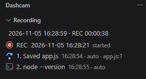
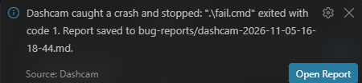
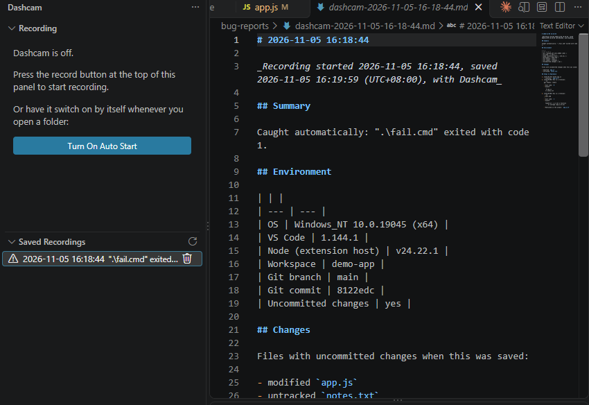

# Dashcam

**A dashcam for your code.** A car dashcam records the road while you drive, and when there is a crash you keep the footage. Dashcam does the same while you work in VS Code: it records what happens, and when something breaks it saves the footage as a shareable Markdown bug report.

> **Status: pre-release (0.4.0).** Dashcam is free and on the [VS Code Marketplace](https://marketplace.visualstudio.com/items?itemName=stanfelixskz.dashcam): search for **Dashcam** in the Extensions view, or see the [install guide](docs/install.md). This repository holds the documentation, tutorials, examples and issue tracker. The extension's source code is not published here.

## See it

**While it records.** The sidebar shows the date and time, a running `REC` clock and the red **REC** line. The red square at the top is the stop button, and the gear opens the settings.



**When it catches a crash.** A failing command stops the recording and saves the report by itself.



**Every saved recording is a report.** Click one in **Saved Recordings** to open the Markdown file. The warning icon marks a crash Dashcam caught.



## How it works, as a dashcam

| A car dashcam | Dashcam in VS Code |
|---|---|
| Has a record button | One **record button**, at the top of the sidebar beside the settings gear. It starts a recording when it is off and stops it when it is on. The status bar shows whether Dashcam is recording. |
| Switches on with the car | Switches on when you open a folder, if you tick `dashcam.autoStart`. |
| Stamps the date and time on the footage | The sidebar shows the date and time and a running `REC` clock. Every recording is titled with its start date and time, and every entry has the time it happened. |
| Records the road ahead | Records what happens in VS Code: terminal commands with their output and exit code, files you save, debug sessions and what they print, new errors in the Problems panel. You type nothing. |
| Loops: keeps the last few minutes and records over the old footage | Keeps a rolling window, 30 minutes by default (`dashcam.bufferMinutes`). |
| Locks the clip when it senses a crash | When a command fails or a debug session crashes, Dashcam **turns itself off and saves the report by itself**, then tells you. Turn it on again when you want. |
| You review the clips afterwards | The **Saved Recordings** list. Each saved recording is a **Markdown report** you can open, paste into a GitHub issue, or send to a teammate. |
| Cannot see inside the other car | Cannot see inside your running app (clicks, what someone types into it). The saved report is a Markdown file, so you can add notes about that part yourself. |

## What is in a report

```markdown
# 2026-11-05 14:08:05

_Recording started 2026-11-05 14:08:05, saved 2026-11-05 14:21:40 (UTC+08:00), with Dashcam_

## Summary                Caught automatically: "node app.js" exited with code 1.
                          + the error, where it points, when this command last
                            passed, what you changed, where you were
## Environment            OS, VS Code, Node, git branch and commit
## Project                project type, tool versions, dependencies
## What changed since it last worked   git, lockfile and config changes between the last pass
                          and the failure, including ones made outside the editor
## How to reproduce       commit, uncommitted state, tool versions, command and folder
## Changes                the files with uncommitted changes (git projects)
## Your uncommitted changes   the real git diff
## Steps to Reproduce     1. 14:08:31 Saved app.js
                          2. 14:08:40 Run in a terminal: node app.js   (exit code 1, with its output,
                             and the file:line locations named in that output)
## Code near the error    a few lines around each file:line the report points at
## Errors and Output      what debug sessions printed
## What this report cannot see   anything dropped or not collected, and the standing limits
```

See a full one in [examples/sample-report.md](examples/sample-report.md). That sample was made with 0.3.0, so it does not show the newest sections.

## What you can do

- **Record automatically.** Terminal commands (with output and exit code), saved files, debug sessions and their output, and new Problems panel errors.
- **Catch crashes.** A failing command or a crashed debug session stops the recording and saves the report, with a message and an **Open Report** button.
- **Show what changed.** In a git project, a **Changes** section lists the files with uncommitted changes. File and line locations named in a command's output, such as stack-trace lines, are listed under it as `file:line`.
- **Get the point at a glance.** The Summary lists the error, where it points, **the last time the same command passed** (and the files you saved in between), what you changed, and where you were.
- **Show what changed since it last worked.** For the failing command, what Dashcam observed between the last time it passed and the failure: the git branch or commit, lockfile and config files that differ, files you saved, and changes made **outside the editor** (a `git checkout`, an `npm install`) with the time each happened. It lists observations only, never a cause.
- **Say how to reproduce it.** The commit and branch, the uncommitted and untracked files, tool versions, the command and its folder, and what the recipe does not cover.
- **Show what changed.** The real `git diff` of your uncommitted changes, so a reader sees exactly what you edited.
- **Never fail silently.** A last section, **What this report cannot see**, lists anything Dashcam dropped or could not collect.
- **Show the code too.** A **Code near the error** section includes a few lines of your code around each `file:line` the report points at, with the lines you changed marked `*`, so one report shows the code as well as the error.
- **Say what it ran on.** The project type, tool versions and dependencies, the folder, shell and duration of each command, and the Problems panel at the time.
- **Stop and decide.** Click the record button again and Dashcam asks whether to save the recording as a report.
- **Browse your recordings.** A **Saved Recordings** list in the sidebar, newest first. Crashes caught automatically have a warning icon and show what failed.
- **Time-stamped, like footage.** The sidebar shows the current date and time and a running clock, and every entry in the report has the time it happened.
- **Edit the recording.** Edit, reorder or delete any entry, and click one to jump to its file.
- **Keep secrets out.** Anything that looks like a password, token, API key, bearer header, JWT, private key or URL credential, including secrets typed on a command line (`--password x`, `curl -u user:pass`), is replaced with `[REDACTED]`.
- **Stay private.** Dashcam makes no network connections. Nothing leaves your computer. See [privacy](docs/privacy.md).

## Learn it in ten minutes

1. [Record your first bug](docs/tutorials/01-record-your-first-bug.md)
2. [Let it record by itself](docs/tutorials/02-let-it-record-by-itself.md)
3. [Find and share your recordings](docs/tutorials/03-save-and-share-the-report.md)

Also: [install](docs/install.md) · [reference: commands and settings](docs/reference.md) · [FAQ](docs/faq.md) · [privacy](docs/privacy.md) · [changelog](CHANGELOG.md)

## Use a report with an AI assistant

If you code with an AI assistant, a report is a much smaller thing to paste than your whole project. It says what failed, in what order, what you had changed, and shows the code around the error. Paste it into the chat and describe what you expected.

Before you paste:

- **Read the report first.** Secret redaction is pattern matching and can miss things, and the report can contain terminal output and code.
- Pasting sends the text to that AI service. If a project is private, set `dashcam.codeContextLines` and `dashcam.diffMaxLines` to `0` to leave code out of reports.

## Limits, stated plainly

- It sees VS Code, not your app. Clicks and typing inside a running app are not recorded.
- Terminal capture needs **VS Code 1.93 or newer** and a terminal with shell integration (PowerShell, bash, zsh and similar). Where it is not available, terminal commands are not recorded.
- A command that is supposed to fail, such as a test run, also counts as a crash and ends the recording. You can switch crash catching off with `dashcam.detectCrashes`.
- Secret redaction is pattern matching. It can miss things. Read a report before you share it.
- Entries older than the rolling window are dropped, and the report says when that happens.
- Outside the editor, Dashcam sees only the git branch and commit and the manifest, lockfile and config files in the project's top folder. Other changes made elsewhere are not seen, so a change not listed may still have happened.

## Help and feedback

- A problem or a missing feature: [open an issue](https://github.com/stanfelixskz/dashcam/issues/new/choose).
- A security problem: please do not open a public issue. See [SECURITY.md](SECURITY.md).

## Licence

Dashcam is freeware: free to use, not open source. See [LICENSE.txt](LICENSE.txt).
