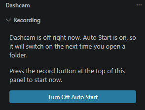

# 2. Let it record by itself

A real dashcam comes on with the car. You do not press anything. Dashcam can work the same way.

## Switch on automatically

The quickest way: when the Dashcam sidebar says Dashcam is off, press the **Turn On Auto Start** button below the text. You can also press Ctrl+Shift+P and run **Dashcam: Turn Auto Start On or Off**. The gear icon at the top of the sidebar opens all of Dashcam's settings.



Or open **Settings** (Ctrl+,), search for **Dashcam**, and tick **Auto Start**. Or add this to your settings:

```json
{ "dashcam.autoStart": true }
```

From now on, a recording begins when you open a folder, titled with the date and time. You are never asked for a name.

## It records the last 30 minutes

A dashcam does not keep every minute of every drive. It loops. Dashcam drops entries older than 30 minutes, so a long day does not bury the bug under hundreds of old steps. Change it with:

```json
{ "dashcam.bufferMinutes": 60 }
```

`0` keeps everything.

## It catches the crash

When a terminal command **exits with an error**, or a debug session **crashes or stops on an exception**, Dashcam turns itself off and saves the report, then tells you:

> Dashcam caught a crash and stopped: "node app.js" exited with code 1. Report saved to bug-reports/dashcam-2026-11-05-14-08-05.md.  **[Open Report]**

The report appears in **Saved Recordings**, marked with a warning icon, with the reason in its summary line. Dashcam stays **off** after a crash. Press the record button at the top of the sidebar to turn it on again. If Auto Start is on, it also starts by itself the next time you open the folder.

Two details:

- It does not treat **Ctrl+C** as a crash. That is you stopping the program.
- A command that is *supposed* to fail, such as a test run, will also end the recording. If that gets in the way, turn the catching off with `"dashcam.detectCrashes": false`. You can still stop and save by hand.

Next: [find and share your recordings](03-save-and-share-the-report.md).
